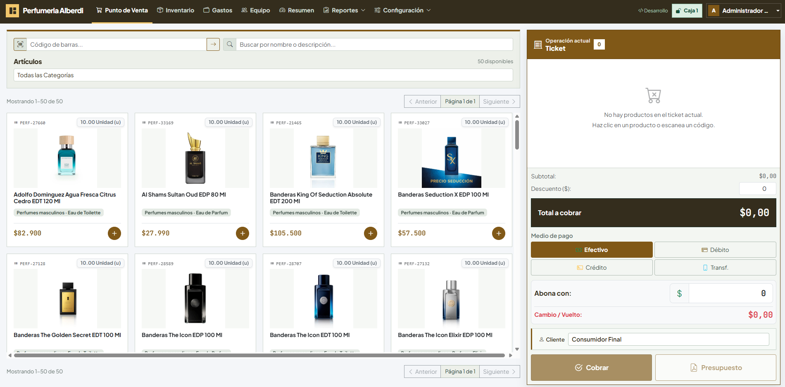
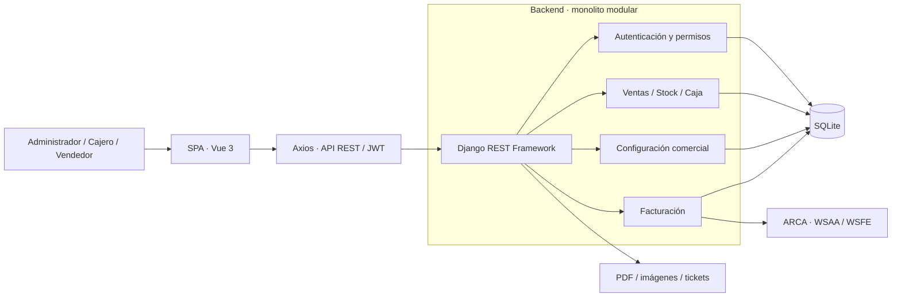
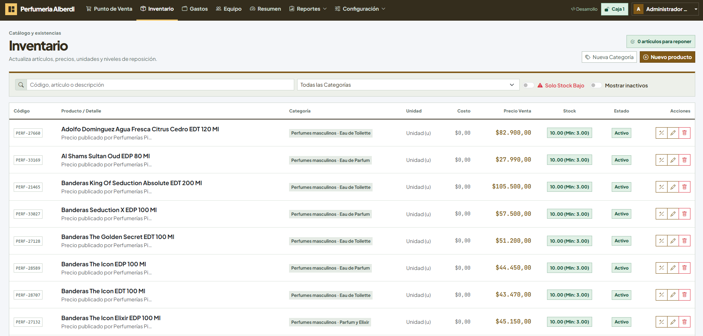
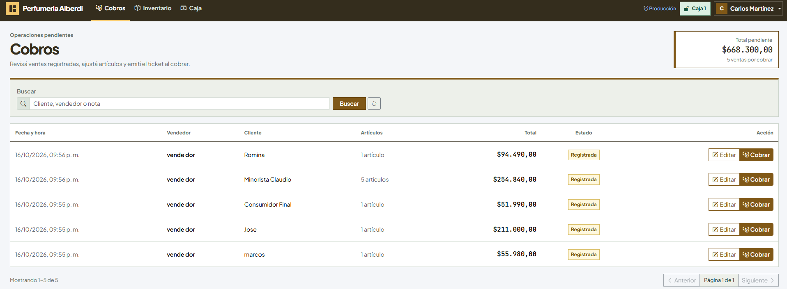
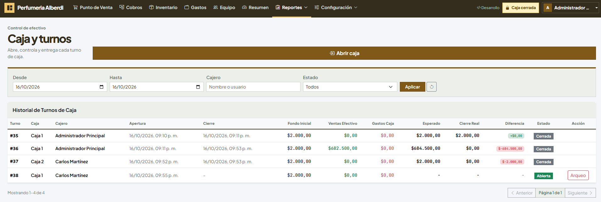

# TPV · Sistema de gestión comercial

**Ventas, inventario, caja y facturación electrónica en una aplicación web.**

Showcase técnico del proyecto TPV, orientado a la operación de comercios minoristas. Presenta el problema de negocio, la arquitectura y las decisiones de implementación para que puedan evaluarse públicamente.

**Autor:** [MarcosBruur](https://github.com/MarcosBruur) · **Repositorio:** [TPV-Showcase](https://github.com/MarcosBruur/TPV-Showcase)

> Este repositorio contiene documentación y material visual. El código fuente de la aplicación se mantiene privado. No contiene una aplicación ejecutable ni una demo pública desplegada.

## Vista del sistema

Catálogo visual, búsqueda de artículos y panel de cobro en una misma pantalla. Las capturas muestran el sistema configurado para una perfumería.

[Ver la galería completa: inventario, cobros y caja](assets/screenshots/README.md)

## El problema

Una operación comercial necesita coordinar la atención al cliente, la disponibilidad de productos, los cobros y el cierre de caja. TPV reúne esos procesos y permite separar el registro de una venta de su cobro, conservando la relación entre operador, mercadería, turno y comprobante.

## Funcionalidades

| Área | Capacidades implementadas |
| --- | --- |
| Punto de venta | Búsqueda por nombre, categoría y código de barras; carrito; cantidades; cobro y vuelto |
| Inventario | Categorías, unidades de medida, imágenes, stock mínimo, ajustes y baja lógica |
| Cobros | Ventas registradas por vendedores, edición y cobro por cajeros |
| Caja | Apertura de turnos, numeración de cajas, cierre y diferencia de arqueo |
| Compras y gastos | Egresos, detalle de mercadería, ingreso de stock y actualización opcional del costo |
| Reportes | Historial de ventas, dashboard y exportación XLSX |
| Documentos | Ticket imprimible y presupuesto PDF informativo |
| Facturación | Integración WSAA/WSFE, facturas A/B/C, autorización, consulta de estado y PDF |
| Administración | Usuarios, roles, identidad del comercio y selección de color |

Las funciones se describen según la implementación local revisada el **16 de octubre de 2026**. Esto no acredita un despliegue productivo ni una certificación externa.

## Arquitectura de un vistazo

La SPA consume una API organizada por dominios. Las reglas operativas y los permisos se validan en el servidor. SQLite es la base configurada actualmente; no se presenta PostgreSQL ni infraestructura distribuida como componentes existentes.

## Tecnologías

| Capa | Tecnologías presentes |
| --- | --- |
| Interfaz | Vue 3, Vue Router, Pinia, Bootstrap 5 y Bootstrap Icons |
| Comunicación | Axios, REST y JWT con SimpleJWT |
| Backend | Python, Django 6 y Django REST Framework |
| Persistencia | SQLite y ORM de Django |
| Documentos y medios | ReportLab, Pillow, QR y exportación XLSX desde el navegador |
| Integración fiscal | WSAA, WSFE y firma CMS |
| Herramientas | Vite, npm y Git |

## Recorrido técnico

- [Arquitectura y estructura del proyecto](docs/ARQUITECTURA.md)
- [Modelo de dominio y relaciones](docs/MODELO-DE-DOMINIO.md)
- [Flujos de ventas, caja y facturación](docs/FLUJOS.md)
- [Decisiones técnicas y límites](docs/DECISIONES.md)
- [Mapa conceptual de la API](docs/API.md)
- [Seguridad y privacidad](docs/SEGURIDAD.md)
- [Estado del proyecto y validación](docs/ESTADO.md)
- [Galería de pantallas y guía de capturas](assets/screenshots/README.md)
- [Guion de demostración](docs/DEMO.md)
- [Cómo mantener y publicar este showcase](docs/PUBLICACION.md)

## Capturas

### Inventario

Consulta de productos, categorías, precios, existencias y estado, con filtros de stock bajo y productos inactivos.

Ver cobros pendientes

Ventas registradas con cliente, vendedor, total y acciones para editar o cobrar.

Ver caja y turnos

Historial de turnos con fondo inicial, movimientos de efectivo, saldo esperado y diferencia de cierre.

[Galería completa y guía para nuevas capturas](assets/screenshots/README.md).

## Aspectos destacados de ingeniería

- Dos modalidades de operación: un cajero con vendedores o múltiples cajeros.
- Reserva de stock al registrar una venta y reconciliación al cobrarla.
- Datos históricos en los ítems de venta para conservar los valores de la operación.
- Relación entre cobros, egresos y turno para calcular el arqueo.
- Persistencia de estados fiscales y consulta para recuperar emisiones de resultado incierto.
- Separación entre ticket comercial, presupuesto informativo y comprobante fiscal autorizado.

## Alcance público

Este material permite evaluar la estructura y el comportamiento del sistema sin distribuir su implementación. No se incluyen bases de datos, certificados, credenciales, documentos fiscales reales ni artefactos compilados.

Consultar [derechos y uso del material](DERECHOS.md).

## Descarga

https://github.com/MarcosBruur/TPV-Showcase/releases/latest
