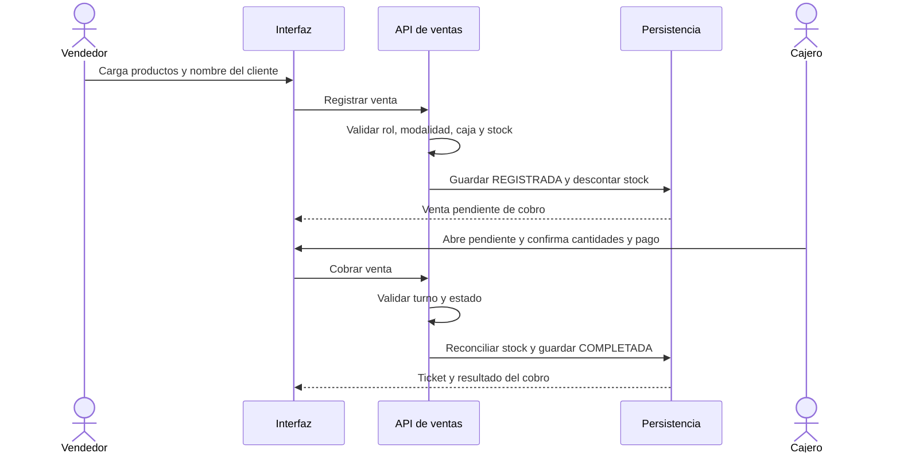
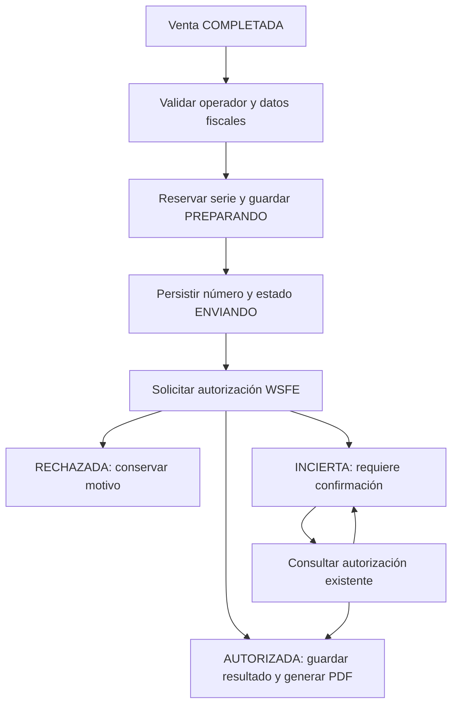

# Flujos de negocio

[Volver a la presentación](../README.md)

## Modalidades y operadores

| Modalidad | Vendedor | Cajero | Administrador |
| --- | --- | --- | --- |
| SINGLE | Registra ventas con caja central abierta | Cobra ventas registradas en su turno | TPV, cobros y administración |
| MULTIPLE | Consulta inventario | Vende y cobra desde TPV | TPV y administración |

Cada turno pertenece a un usuario. La modalidad no representa un modelo de cajas compartidas con varios participantes. Cambiarla requiere cerrar las cajas; para pasar a MULTIPLE también deben resolverse las ventas registradas.

## Registro y cobro en SINGLE

El descuento de stock al registrar actúa como reserva. Al cobrar, el sistema devuelve la reserva anterior y descuenta las cantidades finales dentro de una transacción. Los productos que permanecen en la operación conservan sus valores históricos; los agregados toman los valores vigentes.

Una venta directa completada también requiere turno abierto. La anulación administrativa restituye stock, incluso si la venta todavía estaba registrada.

## Caja y compras

El fondo inicial se combina con ventas cobradas en efectivo y egresos activos en efectivo pagados desde caja. El cierre compara el efectivo informado con ese saldo esperado.

**Saldo esperado = fondo inicial + ventas en efectivo − egresos de efectivo computables.**

Las compras activas ingresan mercadería y pueden actualizar el costo. Los borradores no ingresan stock. Anular una compra revierte el ingreso.

## Emisión fiscal

Es un esquema de los caminos principales, no la totalidad de las transiciones. También puede rechazarse una preparación interrumpida antes de enviar.

WSAA proporciona acceso al servicio fiscal y WSFE gestiona la autorización. El backend conserva estado y resultado para resolver respuestas inciertas por consulta. Las llamadas externas no se mantienen dentro de una transacción SQL prolongada.

El ticket comercial, el presupuesto informativo y la factura autorizada son documentos distintos. Generar un presupuesto no registra una venta ni reserva stock.
