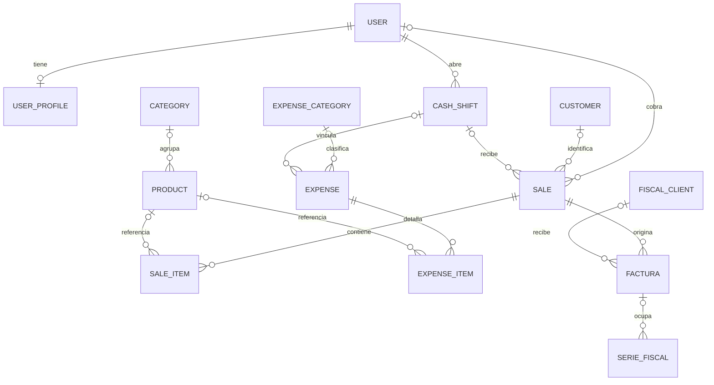

# Modelo de dominio

[Volver a la presentación](../README.md)

Diagrama simplificado de relaciones presentes en los modelos revisados. Omite atributos y algunas relaciones de usuario para facilitar la lectura. No contiene datos de una instalación.

## Entidades principales

| Entidad | Papel |
| --- | --- |
| User / UserProfile | Identidad y rol operativo; la administración se reconoce por indicadores de Django |
| ComercioConfig | Configuración única del comercio, modalidad, tema y datos fiscales |
| Category / Product | Catálogo, precios, unidades, imagen, disponibilidad y stock mínimo |
| Customer | Cliente comercial vinculado opcionalmente a una venta |
| CashShift | Turno de un cajero, número de caja, modalidad y arqueo |
| Sale / SaleItem | Operación comercial y renglones con valores históricos |
| ExpenseCategory / Expense / ExpenseItem | Clasificación de egresos y detalle de compras |
| Client, en facturacion | Registro de receptor fiscal, separado de Customer |
| Factura | Solicitud fiscal, estado, resultado y archivo PDF |
| SerieFiscal | Coordinación de emisión por emisor, endpoint, punto de venta y tipo |

## Reglas que dan forma al modelo

- Una venta registrada puede no tener todavía cajero, turno ni pago. Conserva el usuario que la registró y el nombre de cliente ingresado.
- Los renglones conservan nombre, código, precio y costo históricos. La referencia al producto puede quedar vacía sin perder el detalle.
- La baja habitual de productos es lógica: desactiva su uso para nuevas ventas.
- Las restricciones de turnos evitan duplicar un turno abierto por cajero o número de caja; SINGLE permite una única caja central abierta.
- Una venta puede conservar intentos fiscales rechazados, pero la restricción impide más de una factura no rechazada simultáneamente.
- SerieFiscal coordina una emisión activa; su referencia a Factura no representa una relación uno a uno impuesta por ese campo.
- Un egreso puede relacionarse con un turno cuando afecta la caja.

## Estados

| Entidad | Estados presentes |
| --- | --- |
| Venta | REGISTRADA, COMPLETADA, ANULADA |
| Turno | OPEN, CLOSED |
| Egreso | BORRADOR, ACTIVO, ANULADO |
| Factura | PREPARANDO, ENVIANDO, AUTORIZADA, RECHAZADA, INCIERTA |

El modelo distingue el registro de la venta de su fecha de cobro. El dashboard usa ventas completadas y fecha de cobro; el filtro de fechas del historial usa actualmente la fecha de creación.
